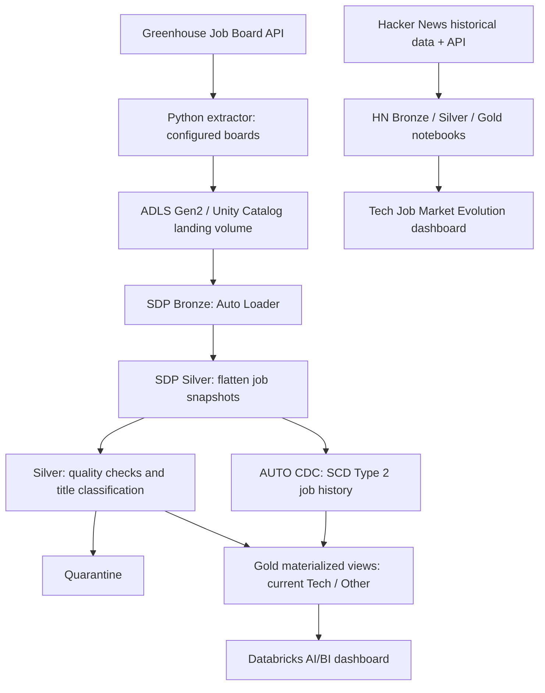
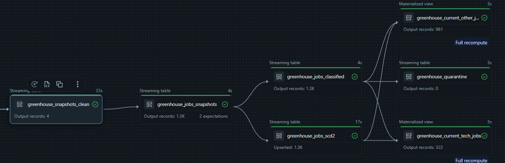
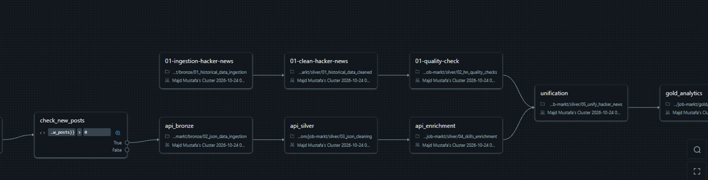
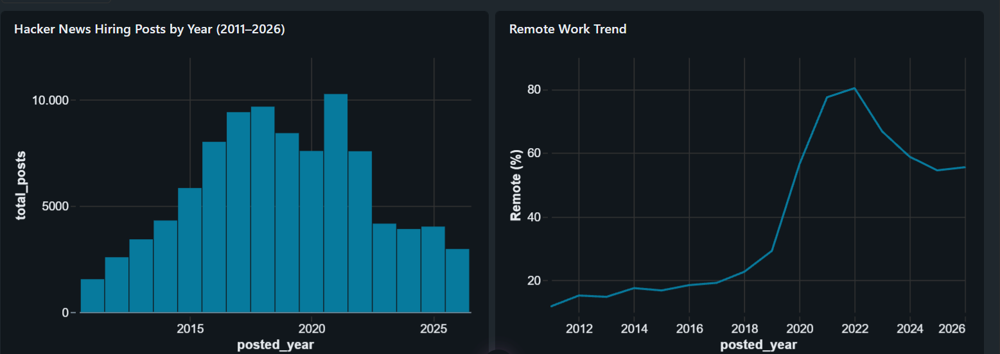
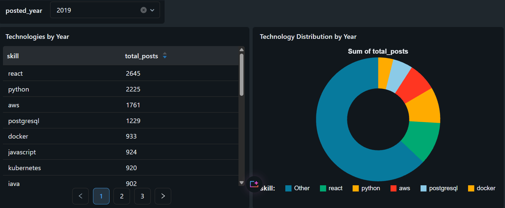

# Tech Jobs ETL Project

An Azure Databricks data engineering portfolio project with two complementary job-market pipelines: historical and incremental **Hacker News "Who is Hiring"** data, and regularly collected **Greenhouse Job Board API snapshots**. The project covers ingestion, data quality, Delta Lake, SCD Type 2 history, analytical views, workflow orchestration, and dashboards.

> **Scope:** Hacker News provides a longer historical perspective; Greenhouse provides point-in-time snapshots of selected companies starting in October 2026. These sources are **not** a representative sample of the entire technology job market, and Greenhouse snapshots do not provide a historical backfill.

## Architecture



### Pipeline execution graphs

The screenshots below show the actual Databricks workflow graphs from the October 2026 project tests. The Greenhouse pipeline is a triggered Lakeflow Spark Declarative Pipeline with streaming Bronze/Silver transformations, SCD Type 2 and Gold materialized views. The Hacker News graph illustrates notebook-based ingestion, quality checks, conditional API processing and the downstream analytical workflow.

**Greenhouse – Lakeflow Spark Declarative Pipeline**



**Hacker News – Lakeflow Job**



**Medallion design**

- **Landing:** Original API responses in immutable, timestamped JSON snapshot files in ADLS Gen2.
- **Bronze:** Incremental file ingestion with Auto Loader (`read_files`); unexpected source fields can be captured in `_rescued_data`.
- **Silver:** Flattening of nested job arrays; data quality expectations; quarantine flags; `is_tech` and `role_family` classification.
- **Historical Silver:** `AUTO CDC INTO` maintains SCD Type 2 versions keyed by **(`board_token`, `job_id`)** and ordered by `snapshot_at`.
- **Gold:** Materialized views combine the latest classification with the current SCD2 row (`__END_AT IS NULL`) so that repeated snapshot observations do not inflate current-job dashboards.

The Greenhouse transformations are implemented using **Lakeflow Spark Declarative Pipelines (SDP)** in SQL. The ingestion notebook and SDP pipeline are orchestrated sequentially by a **Lakeflow Job**.

## Data sources

| Source | Coverage / behavior | Purpose |
| --- | --- | --- |
| Hacker News hiring data | Historical dataset plus Hacker News API, with incremental API checks | Analyze hiring posts and technical skill trends |
| [Greenhouse Job Board API](https://developers.greenhouse.io/job-board.html) | Current public jobs from configurable company board tokens; each request returns a full snapshot | Compare companies, technical roles, locations, and changes observed over time |

The Greenhouse extractor accepts a comma-separated `boards` parameter. It was tested with **anthropic, cloudflare, figma, and greenhouse**. These are example boards, not hard-coded pipeline limits.

### Greenhouse flow

1. `bronze/04_greenhouse_api_extract.ipynb` calls each configured public board endpoint, validates the reported job count and unique job IDs, and writes one JSON file per company per run to `/Volumes/job_market/landing/raw_files/greenhouse_snapshots/`.
2. `greenhouse_sdp/transformations/bronze.sql` incrementally ingests the newly arrived files.
3. `silver.sql` expands the `jobs` array into one observation per job per snapshot. Repeated job IDs across different snapshots are expected here.
4. `classification.sql` applies quality checks and heuristic job-title rules; records are split into technical, other, and quarantine categories.
5. `scd2.sql` stores initial states and relevant subsequent attribute changes, without creating a new SCD2 version solely because a new snapshot arrived.
6. `fanout.sql` defines the current Tech and Other **Gold materialized views**, plus a Silver quarantine streaming table. The Gold views keep one current row per company/job ID.

**Important distinction:** Auto Loader is incremental at the *file* level; Greenhouse API requests are still *full snapshots*. SCD2 tracks observed changes in selected job attributes. The pipeline does **not yet detect job removals**: a job that disappears from the source may remain in the last-known-current Gold view. Snapshot publication is also not yet fully transactional across all company files.

## Technical stack

- Azure Databricks, Lakeflow Jobs, Lakeflow Spark Declarative Pipelines (SQL)
- Apache Spark / PySpark and SQL
- Delta Lake: `MERGE`, SCD Type 2, Change Data Feed (CDF), Time Travel
- Azure Data Lake Storage Gen2 and Unity Catalog volumes, catalogs, and schemas
- Databricks AI/BI dashboards
- Git and GitHub (CI/CD deployment work in progress)

## Greenhouse datasets

| Table / view | Type | Purpose |
| --- | --- | --- |
| `job_market.bronze.greenhouse_snapshots_clean` | Streaming table | Raw API snapshot envelopes |
| `job_market.silver.greenhouse_jobs_snapshots` | Streaming table | Flattened job observations, including `snapshot_id` |
| `job_market.silver.greenhouse_jobs_classified` | Streaming table | Validation, `is_tech`, `role_family`, quarantine reason |
| `job_market.silver.greenhouse_jobs_scd2` | CDC-managed streaming table | Historical versions (`__START_AT`, `__END_AT`) |
| `job_market.silver.greenhouse_quarantine` | Streaming table | Quarantined observations |
| `job_market.gold.greenhouse_current_tech_jobs` | Materialized view | Latest known technical job states |
| `job_market.gold.greenhouse_current_other_jobs` | Materialized view | Latest known non-technical job states |

The `role_family` labels are **rule-based title classifications**, not ground truth. Work-arrangement and country classifications are also heuristic and source-specific; ambiguous values remain `Unknown` or unclassified. A job may be associated with multiple countries, so country totals may exceed the number of distinct jobs.

## Dashboards

### Greenhouse Tech Job Market

[Dashboard definition](dashboards/Greenhouse%20Tech%20Job%20Market.lvdash.json) · [Preview screenshot](resources/docs/Tech%20vs.%20Other%20Jobs.png)

The dashboard contains:
- Total jobs, Tech jobs, and Tech share KPIs
- Tech vs. Other jobs by company
- Technical job categories (`role_family`)
- Work-arrangement labels (including an explicit Unknown category)
- Office-country comparisons

These describe the **latest known** job states, not a verified real-time count of currently open positions.

### Tech Job Market Evolution (Hacker News)

[Dashboard definition](dashboards/Tech%20Job%20Market%20Evolution.lvdash.json)





## Validation and observed results

The following results were observed during development on **27 October 2026**; they are snapshots of a test run, not continuously updated claims:

- Four configured Greenhouse boards processed successfully using the same extractor and SQL transformation definitions.
- Gold current-state counts: **Anthropic 679**, **Cloudflare 465**, **Figma 141**, **Greenhouse 18** (**1,303** in total).
- The SCD2 table had **1,309 total historical rows** after the later merge; the difference from 1,303 current rows reflects previous historical versions.
- An initial Delta CDF read of SCD2 commit version **2** returned **1,279 `insert` events**.
- Delta Time Travel successfully compared the table before and after the later merge (versions **2** and **3**); an additional `OPTIMIZE` operation created version **4** without changing the logical job count.
- The Hacker News API workflow condition correctly skipped downstream processing when there were no new posts.

Example read-only checks:

```sql
-- Historical Delta commits (technical table versions)
DESCRIBE HISTORY job_market.silver.greenhouse_jobs_scd2;

-- CDF events from the first observed SCD2 data commit
SELECT _commit_version, _change_type, COUNT(*) AS affected_rows
FROM table_changes('job_market.silver.greenhouse_jobs_scd2', 2, 2)
GROUP BY _commit_version, _change_type;

-- Current Tech jobs per board
SELECT board_token, COUNT(*) AS job_count
FROM job_market.gold.greenhouse_current_tech_jobs
GROUP BY board_token;
```

> Delta Time Travel and CDF reads depend on the availability and retention of historical Delta data. The example version numbers belong to the development workspace and will differ in another deployment.

## Repository map

```text
bronze/             # Historical/API ingestion notebooks
silver/             # Cleaning, data quality, enrichment, unification
gold/               # Hacker News analytical notebooks
helper/             # Shared notebook helpers
set-up/             # Environment setup
greenhouse_sdp/
  transformations/  # bronze.sql, silver.sql, classification.sql, scd2.sql, fanout.sql
resources/           # Lakeflow Job YAML exports
  docs/             # Dashboard screenshots
dashboards/          # Databricks dashboard JSON exports
```

## Running in Databricks

This repository is a **workspace-specific development snapshot**, not yet a portable one-command deployment.

1. Prepare an Azure Databricks workspace with a Unity Catalog catalog named `job_market`, the required `landing`, `bronze`, `silver`, and `gold` schemas, and an accessible ADLS-backed landing volume.
2. Configure a Git Folder for the repository and choose the development branch.
3. Import/configure the SDP code under `greenhouse_sdp/transformations/` in a *triggered* pipeline.
4. Configure the two-task Lakeflow Job from [`resources/greenhouse_ETL.yml`](resources/greenhouse_ETL.yml): **API notebook → SDP pipeline**, with the notebook's `boards` job parameter.
5. Run a normal pipeline update; do not use Full Refresh unless explicitly resetting state. The current YAML contains workspace-specific notebook path, compute ID, and pipeline ID that must be adapted for a different workspace.

The SDP pipeline currently uses Serverless compute, while the extractor uses an existing Classic cluster. **Compute incurs cost**; avoid unnecessary refreshes and long-running clusters. Do not commit API keys or other secrets.

## Engineering lessons and limitations

- **Incremental files vs. snapshots:** Each scheduled API call may return many unchanged jobs; Auto Loader handles only new files, whereas SCD2 avoids creating a new *historical state* for unchanged tracked attributes.
- **Separate raw observations from current-state analytics:** Do not count the append-only Silver snapshot table as a unique current-job count.
- **Source quality matters:** Greenhouse companies encode location and work arrangement differently. Preserve `Unknown` when classification is uncertain.
- **Deletion detection is deferred:** Full-snapshot comparison and safe publication/approval are future work. `__END_AT IS NULL` currently means *last known current state*, not proof the job is still published.
- **Operational hardening pending:** Idempotency under extractor retries, atomic multi-company snapshot publication, automated quality assertions, monitoring, and deployment portability need additional work.
- **CI baseline available:** GitHub Actions runs offline source-contract checks on pushes and pull requests (notebook Python syntax, YAML, SQL structure and job dependencies). Portable Databricks Declarative Automation Bundles and authenticated deployment/CD are still pending.

## Status / next steps

- [x] Historical and API-based Hacker News ingestion
- [x] Greenhouse API extraction for configurable company boards
- [x] Incremental Auto Loader Bronze → Silver processing
- [x] Quality checks, quarantine, and rule-based classifications
- [x] SCD Type 2 job history and CDF / Time Travel verification
- [x] Current-state Gold materialized views and AI/BI dashboard
- [x] Lakeflow orchestration and GitHub source control
- [ ] Portable Databricks bundle configuration and CI validation
- [ ] Monitoring, recovery, and safer snapshot publication
- [ ] Reliable removal detection for closed job postings

**Data interpretation:** Job boards reflect selected sources and companies, not the entire labor market. Observed first-publication dates, last-updated dates, and our snapshot collection timestamps represent different concepts and must not be conflated.
